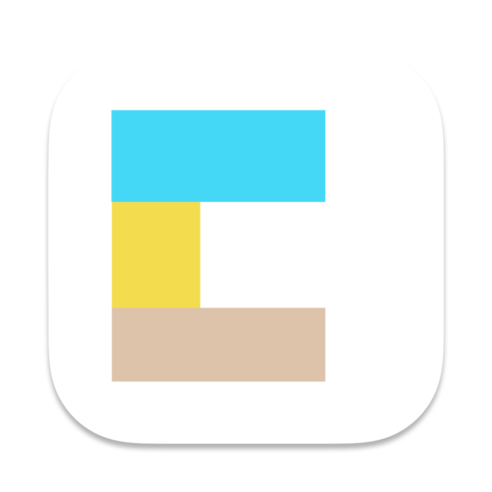

<p style="text-align:center">
  
</p>

# Getting Started
とにかくCommentableを利用するだけ，という方は以下のページを参照してください．
  * https://tetsuakibaba.github.io/commentable/

# Compatibility
  * 配信者 commentable-desktop
    * [x] macOS
    * [x] Windows
    * [ ] Linux
  * 視聴者 webpage
    * Chrome
    * Firefox
    * Safari
    * Edge

# Installation

## Local Server
local環境での実行手順を示します。デプロイするときはデプロイ先の指示に従ってください。

```
$ git clone https://github.com/TetsuakiBaba/commentable.git
$ cd commentable
$ npm install
$ node server.js
open http://localhost on Chrome/Firefox browser for student mode
```

## Desktop Application
配信者はデスクトップアプリケーションである commentable-desktop を利用することで、コメントを自身のデスクトップ上に表示することができます。ビルドしたアプリケーションは以下からダウンロードできます。
  * https://github.com/TetsuakiBaba/commentable/releases


公式ページ (https://tetsuakibaba.github.io/commentable/) には最新版のダウンロードリンクが貼られています。ビルド済みアプリケーションではcommentableのデプロイ先が固定されているため，自身のサーバ環境で実行する場合は、以下の手順でビルドを行ってください。

### macOS 版（Swift ネイティブ版）
macOS 向けは Swift で書き直したネイティブ版（[macos/](macos/)）に移行します（macOS の Electron 版は廃止予定です）。
ビルド・バージョン管理（`macos/VERSION`）・GitHub へのリリース手順は [macos/README.md](macos/README.md) を参照してください。
リリース用の署名・ビルド・公証は GitHub Actions（Actions タブの「macOS app」→「Run workflow」）で行います。

```
cd macos
./build.sh      # 手元でのビルド
```

以下は Electron 版の手順です。

### Build
Electron 版のビルドには Node.js 22.13 以降が必要です（Electron 45・Electron Forge 8）。`npm install` のあとに Electron 本体が自動でダウンロードされます。

以下の手順で自身でビルドすることもできます。また別のサーバにデプロイしている場合は、electron/main.js の url を変更してください。ローカル環境でテストさせる場合はmain.js内の const USE_LOCAL_SERVER = true; を設定してください。

```
cd electron
npm install
npm exec --package=@electron-forge/cli -c "electron-forge import"
npm run make
```

intel chip macOS 用も一緒にビルドする場合は以下のコマンドを利用してください
```
npm run make -- --arch=x64,arm64
```

### Release（GitHub リリース）
`npm run publish` はビルド（make）から GitHub へのアップロードまでを行うため、事前に `npm run make` を実行する必要はありません。リリースは下書き（draft）として作成されるので、GitHub のリリースページで公開すると、配布済みのアプリに自動アップデートが届きます。
```
cd electron
npm run publish -- --arch=x64,arm64
```
リリース前に、`electron/package.json` の `version` を上げ、`electron/main.js` の `USE_LOCAL_SERVER` が `false` になっていることを確認してください。

## 不適切用語のフィルタリング
投稿ページでは、コメントや名前に不適切な用語が含まれていると送信前にダイアログを表示し、修正するまで送信できないようにしています（伏せ字にはしません）。判定は public/word_filter.js で行い、用語のリストは public/inappropriate-words-ja/blocklist.base64.txt に base64 化して保存しています。

リストは [https://github.com/MosasoM/inappropriate-words-ja](https://github.com/MosasoM/inappropriate-words-ja) をもとに、「含まれていたら間違いなく不適切」な語だけに絞ったものです（「マイク」が引っかかる「イク」のように、普通の言葉に含まれてしまう語や、授業で使われうる医学・法律の用語は除いています）。リストを変更するときは、blocklist.txt（git 管理外）を編集してから base64 化してください。

```
cd public/inappropriate-words-ja
node convert_to_base64.js
```

## 管理者ページ (ダッシュボード) のセットアップガイド
管理者ページ (ダッシュボード) のセットアップ方法について説明します。ダッシュボードはコメントの管理や設定変更を行うためのインターフェースです。 詳細なセットアップ手順は以下のリンクを参照してください。
[ダッシュボードのセットアップガイド](DASHBOARD_SETUP.md)

# Author
  * Tetsuaki Baba
    * Tokyo Metropolitan University
    * https://tetsuakibaba.jp

# License
一部の音声ファイルを除き、Commentableは MIT ライセンスにて配布しています。